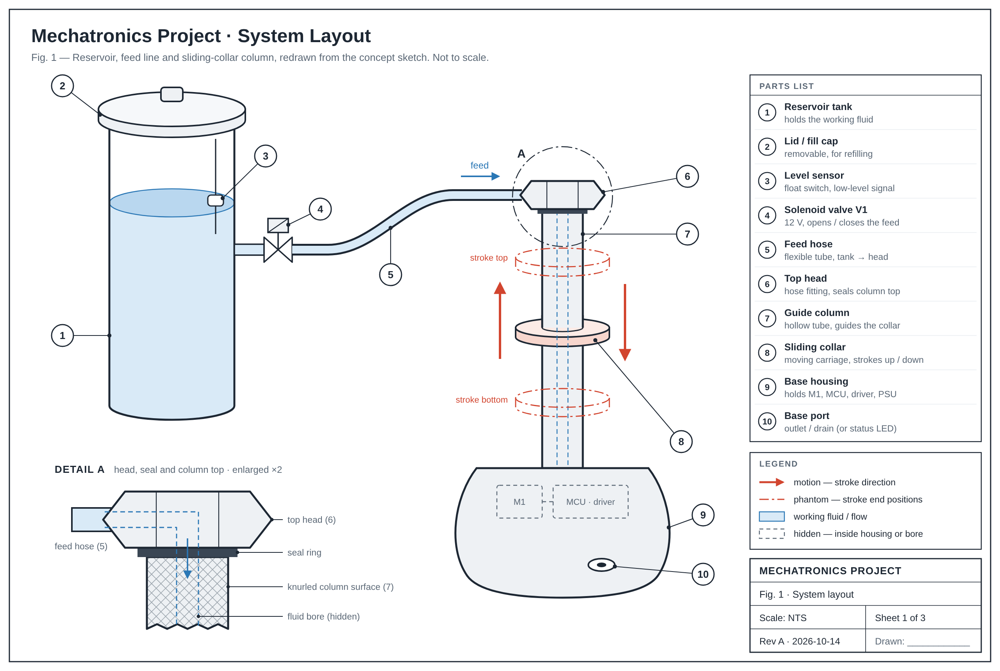
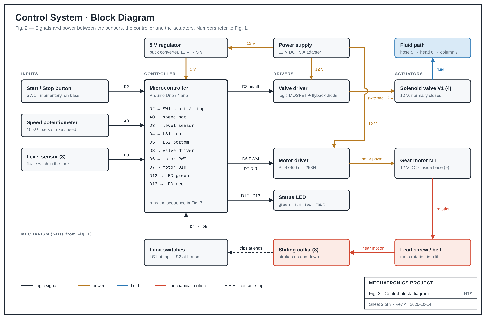
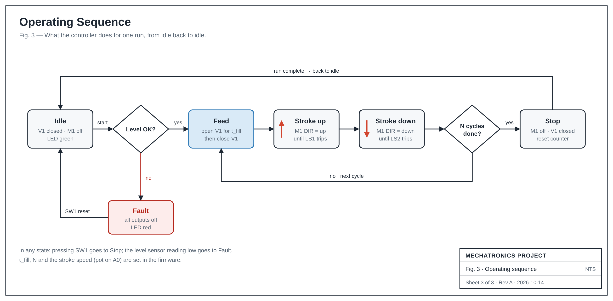

# Mechatronics Project: Diagrams

These are cleaned-up engineering diagrams made from the hand-drawn concept sketch:
a reservoir tank feeds a vertical column through a hose, and a collar slides up and down that column.
The column stands on a base housing.

| File | What it shows |
| --- | --- |
| `fig1-system-layout.svg` / `.png` | Mechanical layout with numbered parts, the collar's stroke, a parts list and Detail A (head and column top) |
| `fig2-control-block-diagram.svg` / `.png` | Sensors → controller → drivers → actuators, power supply, and the mechanical feedback loop |
| `fig3-operating-sequence.svg` / `.png` | Controller state flow: idle, level check, feed, stroke up/down, repeat, stop, fault |

The SVGs scale without blurring for reports and posters. The PNGs are 2× resolution for Word and PowerPoint.

## Fig. 1: System layout



| No. | Part | Function |
| --- | --- | --- |
| 1 | Reservoir tank | Holds the working fluid |
| 2 | Lid / fill cap | Removable, for refilling |
| 3 | Level sensor | Float switch, sends a low-level signal |
| 4 | Solenoid valve V1 | 12 V, opens and closes the feed |
| 5 | Feed hose | Flexible tube from tank to head |
| 6 | Top head | Hose fitting, seals the top of the column |
| 7 | Guide column | Hollow tube that guides the collar |
| 8 | Sliding collar | Moving carriage, strokes up and down |
| 9 | Base housing | Holds motor M1, controller, driver and power supply |
| 10 | Base port | Outlet / drain (or a status LED) |

## Fig. 2: Control block diagram



Suggested Arduino pin map:

| Pin | Direction | Connected to |
| --- | --- | --- |
| D2 | in | SW1 start/stop button |
| A0 | in | Speed potentiometer (10 kΩ) |
| D3 | in | Level sensor (float switch) |
| D4 | in | LS1, top limit switch |
| D5 | in | LS2, bottom limit switch |
| D8 | out | Valve driver (MOSFET) → solenoid valve V1 |
| D6 | out (PWM) | Motor driver speed |
| D7 | out | Motor driver direction |
| D12 / D13 | out | Status LED green / red |

## Fig. 3: Operating sequence



## Assumptions to check

These diagrams are one reading of a rough sketch. Change any of the following that don't match the real design:

- The collar (8) is the moving part, because the sketch's up/down arrows sit beside it.
  A motor in the base drives it through a lead screw or belt.
- The hose feeds the top head (6). Fluid runs down the hollow column to the base port (10).
- Detail A is a close-up of the head, seal and column top. That is how I read the small separate drawing at the bottom left of the sketch.
- The parts in Fig. 2 (Arduino, BTS7960/L298N, float switch, limit switches) are suggestions, not requirements.

## Editing

Every label and position is set in `build_diagrams.py`. After editing it, regenerate the SVGs:

```bash
python3 docs/mechatronics/build_diagrams.py
```

To make new PNGs, open an SVG in any browser and take a screenshot, or export it from Inkscape.
